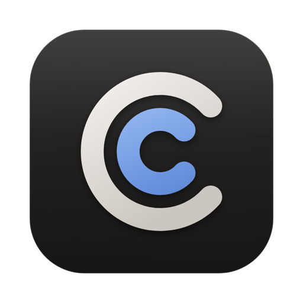

<p align="center"></p>

<h1 align="center">Compagnion</h1>

<p align="center">Run Claude Code and Codex agents in parallel on your Mac, each in its own git worktree.</p>

Compagnion is a native Mac app for coding agents. Every task gets its own git worktree and branch, so several agents can work at once without getting in each other's way. You follow along, approve, review the diff of every turn, open a pull request and merge, all from one window.

This repository holds the releases of Compagnion and its issue tracker. The source code is not public.

## Install

With [Homebrew](https://brew.sh):

```sh
brew install --cask innovative365nl/tap/compagnion
```

This installs the app and the `compagnion` command-line tool.

Or download the disk image from the [latest release](https://github.com/innovative365nl/compagnion/releases/latest) and drag Compagnion to Applications. It's signed with a Developer ID and notarized by Apple.

Compagnion updates itself: every six hours it checks for a new release and switches to it once no agent is busy (Settings → General → Update automatically).

## What you need

- macOS 14 Sonoma or later, on a Mac with Apple silicon
- git (comes with the Xcode Command Line Tools)
- [Claude Code](https://docs.claude.com/en/docs/claude-code/overview) and/or [Codex](https://github.com/openai/codex), signed in
- For pull requests and issues: the [GitHub CLI](https://cli.github.com) (`gh auth login`)

## What it does

- **Parallel, each in its own worktree.** Start as many workspaces as you like; your own checkout stays untouched.
- **Claude Code and Codex** in the same chat, with the same tools and approvals.
- **What every turn changed.** Compagnion snapshots the working tree around every turn; revert a turn with one click.
- **From issue to merge.** Start from a GitHub issue, let a model write the pull request, follow the checks and merge from the app.
- **Dashboard** with every workspace as a card, in a column per status.
- **Setup, run and terminals** per repo, with a preview of your dev server.
- **Keeps working.** The agents run in a daemon: close the window and the work carries on, and your Mac stays awake while an agent is busy.
- **Everything on your own Mac.** No account and no server in between; the agents use your own subscription or API key.
- **Native.** Built in SwiftUI, no Electron and no web view. A native Windows app is coming.

## Feedback

Found a bug or missing something? [Open an issue](https://github.com/innovative365nl/compagnion/issues/new/choose).

---

© 2026 Innovative365 B.V. All rights reserved.
